# The Freshmen Journey

## Table of contents
- [About](#about)
- [Project feature](#project-features)
- [Technical aspects](#technical-aspects)
- [Commands](#commands)
- [Documentation](#documentation)
- [License](#license)

## About
The Freshman Journey is a 2D maze video game inspired by *Bomberman* and developed using the [libGDX](https://libgdx.com/) framework and the MVC design pattern. 
It follows the adventures of an alien who has come to Earth to earn a degree in every university course, finding himself up against rival students and difficult exams to pass.

> [!WARNING]
> The Freshman Journey is a university project focused on Oriented Object Programming (OOP) and design pattern.

> [!WARNING]
> The characters in the Computer Science course were created with the stereotypes associated with the image of the “computer scientist” in mind—
> how he might be perceived from the outside. The intention behind this is to poke fun at them, laugh them off, and take them
> lightly; it is in no way meant to imply that I believe in those stereotypes or consider them true—quite the opposite,
> I firmly believe that this is a misleading image that in no way represents reality.

> [!NOTE]
> The game was designed with the idea of having multiple courses, but only one has been implemented (the Computer Science course).
> We won't be continuing with this project, but if you'd like to take it on (e.g. by adding other courses), you're welcome to do so!
> Run `git clone` and glhf :)

## Project features

### Main screen
The main screen introduces the player to the various parts of the game: matches, the editor, settings, and the user profile.

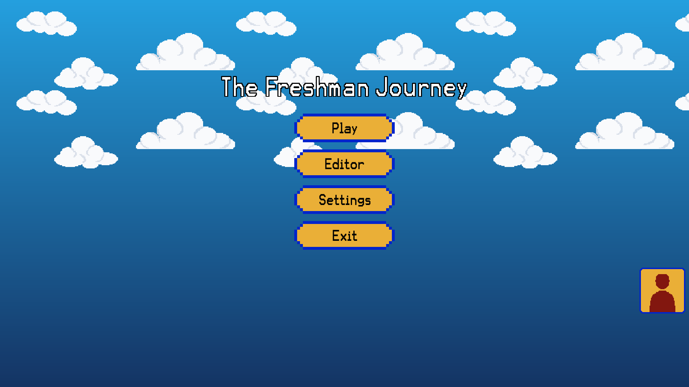

### User profile
The user profile is designed as a screen featuring an avatar, a customizable nickname, and game statistics.
The game statistics include defeated bosses (recorded exams), bosses to be defeated (available exams),
points earned from defeated bosses (total CFU), completed worlds (degrees obtained), games played (lessons attended), games lost (lessons quit), games won (lessons completed), win-loss ratio (quit/completed lesson ratio), enemies defeated (defeated students), player deaths (deaths), and kill-death ratio
(defeated students/death ratio).

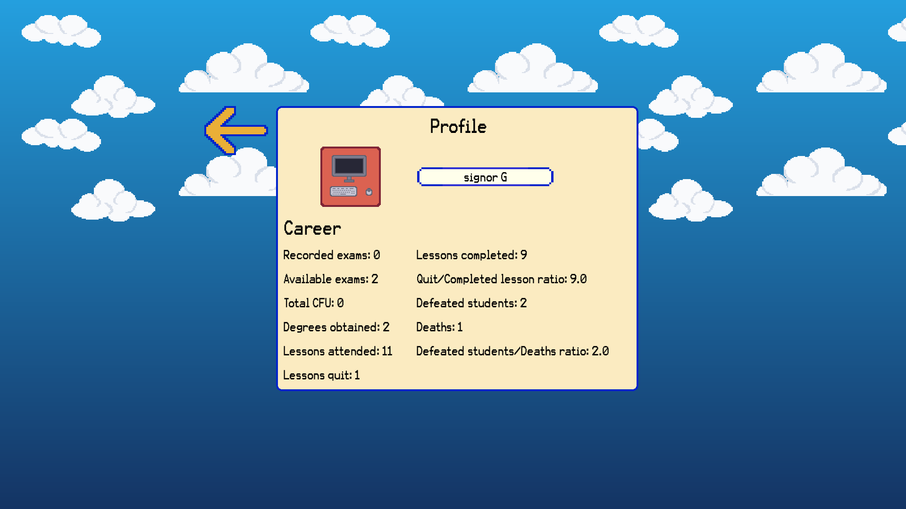

### Gameplay
The game is divided into several worlds with different settings and characters (called
courses). Each course consists of 8 levels (called lessons), two of which feature
a boss (called an exam). 
The player must complete all the lessons in a course to finish it.
Defeat
Each level features a map, the player, power-ups, enemies,
and screens.

  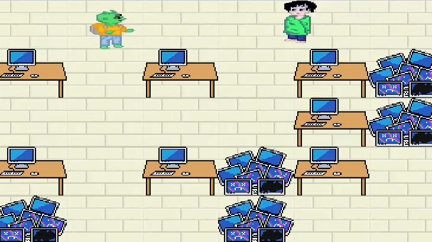 
  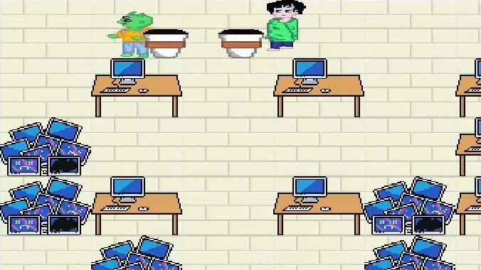
  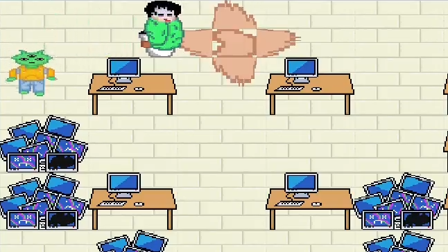

  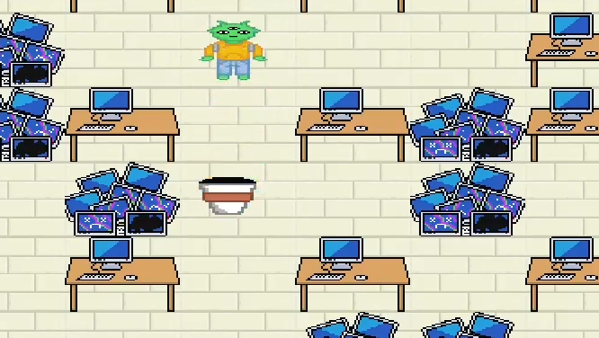 
  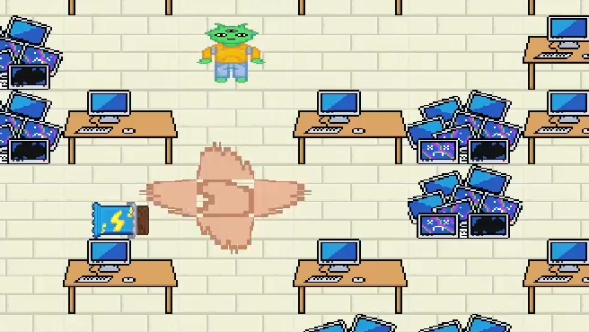
  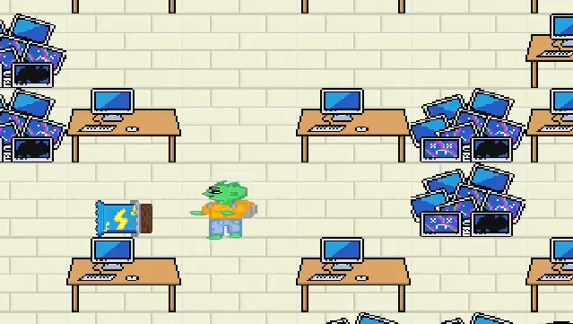

  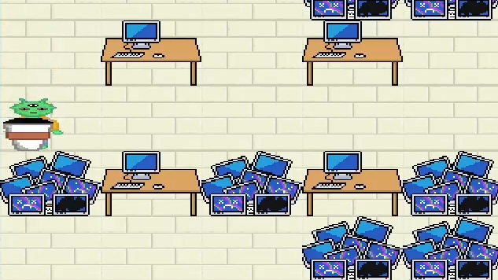 
  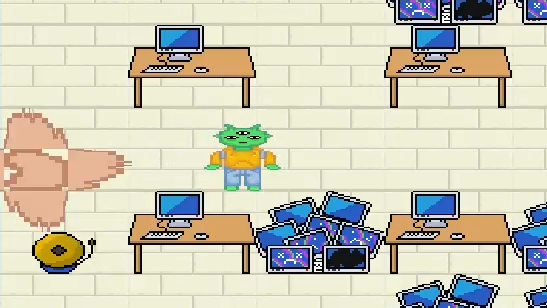
  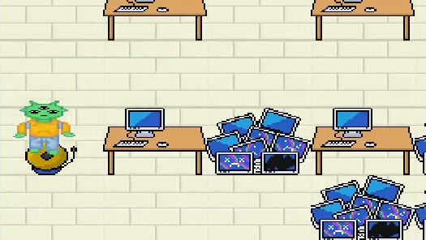

#### Map
The map is viewed as a grid of blocks.
Blocks can be:
- *Destroyable blocks*: blocks that can be destroyed by the player’s bombs (such as electronic trash).
  They hide power-ups and the exit.
- *Non-destructible blocks*: blocks that cannot be destroyed by the player’s bombs (such as walls, desks, and the floor).

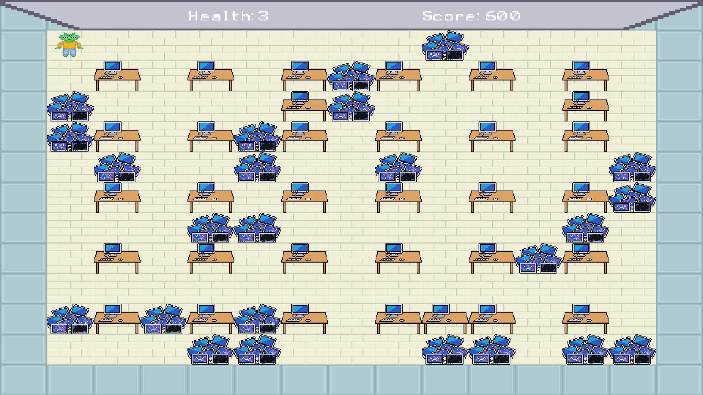

#### Player
The alien student’s goal is to find the exit by destroying breakable blocks and any enemies that stand in his way using his main weapon: coffee—a bomb that deals area damage.
The player can control him using the keyboard or mouse.

  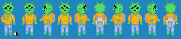

#### Power up
Power-ups increase or decrease the character's abilities through their effects.
The power-ups are:
- *Shield*: a power-up that allows the player to be hit without taking damage. 

- *More coffee*: a power-up that allows the player to drop one additional bomb at a time. 

- *More heart*: a power-up that increases the player's health by one. 

- *Junk food*: a power-up that subtracts 500 points from the player’s score. 
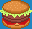

- *Energy drink*: a power-up that adds 500 points to the player’s score. 

- *Energy bar*: a power-up that adds 1,000 points to the player’s score. 

- *Pillow*: a power-up that slows the player down. 

- *Broken heart*: a power-up that reduces the player’s health by one. 

#### Enemies
Enemies are characters with their own gameplay behavior designed to hinder the player’s quest to find the exit. They take away the player’s health when they hit the player, while granting the player points when they die.

They are divided into two types:
- *Normal enemies*: enemies found in normal levels that are easy to defeat and
  represent the students in that course.
  All enemies are able to walk on the floor.
  The types of normal enemies (for the Computer Science course) are:
  - *Homebody*: a fast enemy, but with low health. 
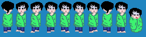

  - *Geek*: a moderate enemy, with sufficient health and able to walk even on destructible blocks.,
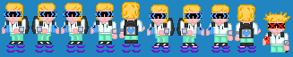

  - *Gamer*: an enemy with a lot of health, but one that doesn’t move. 
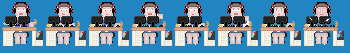

  - *Hacker*: a moderate enemy with sufficient health and the ability to defuse the player’s bombs. 
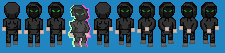

- *Boss*: enemies found in special levels that have characteristics making them difficult to defeat
and represent the students in that course.
  They can walk on any block except walls.
  The types of bosses (for the Computer Science course) are:
  - *Algorithms*: a fast, medium-sized boss with sufficient health. 
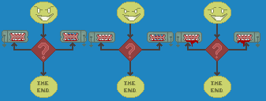

  - *Databases*: a slow, large boss with a lot of health. 
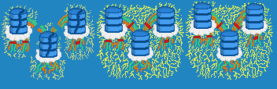

#### Screens
Screens pause the game depending on the event that has occurred and allow the user to return to the main screen by clicking a dedicated button.
The types of screens are:
- *Victory screen*: a screen that appears when the player wins by completing all the lessons in a course.
- *Defeat screen*: a screen that appears when the player loses.

  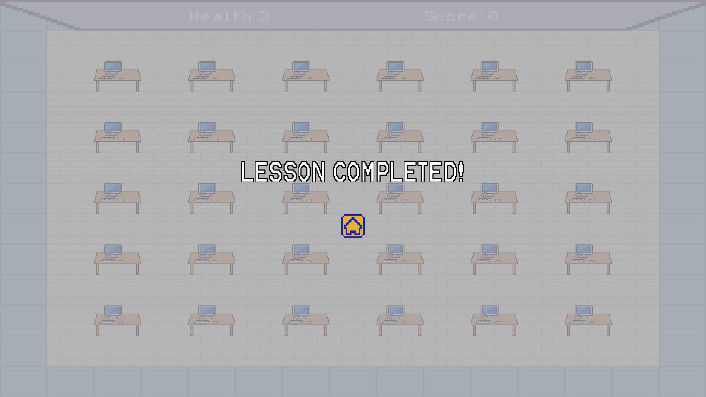 
  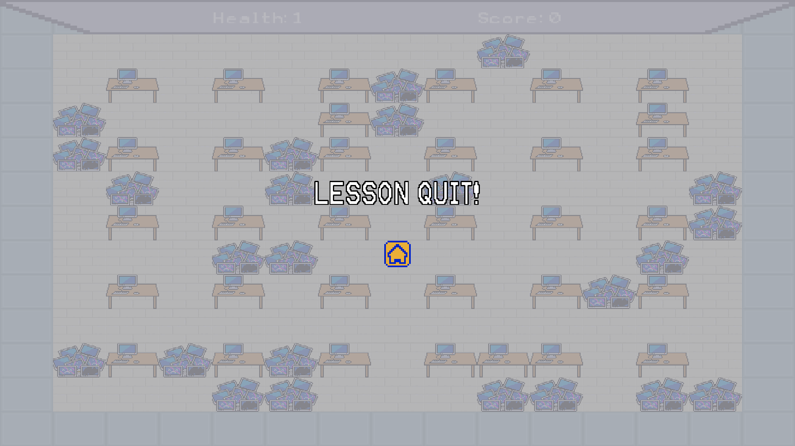

### Editor
The game provides an editor that includes a course with a level that can be customized and played by the player.

The actions the player can perform on the custom level are:
- *Creation:* The player can customize the level by selecting blocks or enemies using the corresponding keyboard keys and adding them to the level with a mouse click.
- *Saving:* The custom level can be saved to a file, loaded, or reset.
- *Playing:* The custom level can be played by the player.

### Settings
The game offers various settings that allow you to adjust the volume of the music and sound effects and to reset
your game statistics profile.

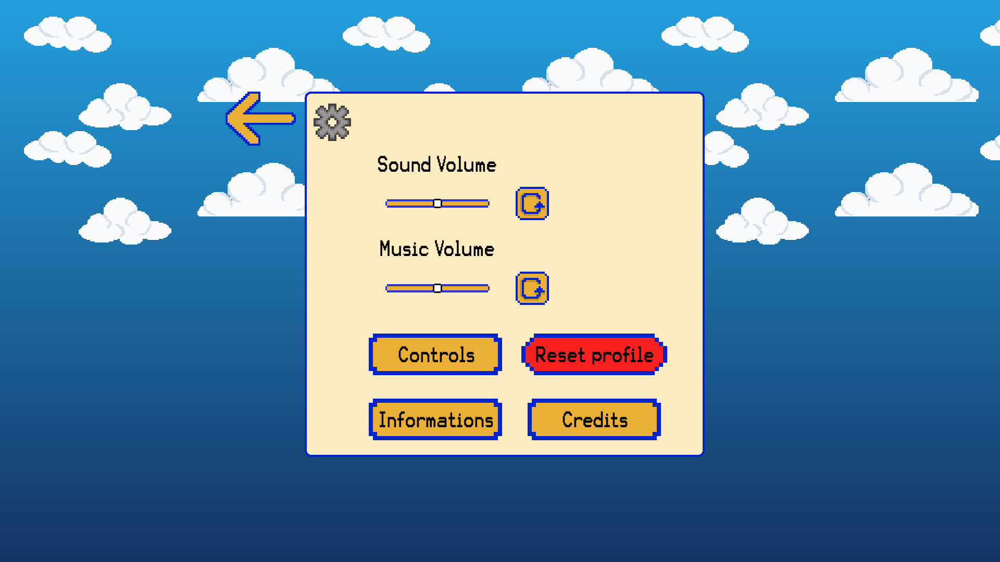

## Technical aspects

### Design pattern
Several design patterns were applied in the game, including:

- *Model-View-Controller (MVC)*: This design pattern was applied to the entire game to separate the game’s logic from its user interface, thereby ensuring better code reusability and maintainability.
  The Model represents the game’s logic, containing the functionality and rules of the various components. The View represents the game’s user interface. The Controller acts as the manager responsible for coordinating the Model and the View to process requests.
  Each screen that makes up the game, along with its lifecycle, was treated as a Controller with its own Model and View.
  A main Controller is responsible for managing all the other controllers.
- *Observer-Observable*: This design pattern was applied to allow the Model to communicate directly with the View without going through the Controller, while at the same time preserving the MVC structure when an object needs to send a message to multiple other objects.
  The level Model was treated as an Observable, and the character Views were treated as its Observers, so that characters become invisible when the level ends, thereby changing their state.
- *Singleton*: This design pattern was applied to all Controller classes that manage the game screens and audio, as well as to the statistics and player Model classes, to ensure that these classes are instantiated only once and that this instance is accessible globally within the program.

### GUI
The graphical user interface was implemented using [libGDX]([libGDX](https://libgdx.com/)) in two different ways:

- *Menu screens*: The various menu screens were implemented as logical tables containing the various menu elements (e.g. buttons, labels, text fields…).
- *Gameplay screen*: The gameplay screen was implemented as a world with its own coordinates and units, viewed through a camera.
  The world’s components (e.g. blocks, enemies, the player, etc.) were designed as images drawn within an invisible rectangle used to handle collisions with other components.

### Stream
Streams were used to open and read/write files containing an array of integers that represents the game map and its components.

### Audio
The game's audio was handled using several classes provided by [libGDX]([libGDX](https://libgdx.com/)) for managing sounds and music.
Two singleton controllers were created to manage the game's sounds and music separately; these controllers provide functions for controlling the audio, such as playback, pause, and switching tracks.

## Commands
Below is a list of commands that vary depending on whether you're in normal game mode or the editor.

### Normal game commands
Keys for moving the character:
- *W* or *click at the top of the screen*: The character moves up.
- *A* or *click on the left side of the screen*: The character moves left.
- *S* or *click at the bottom of the screen*: The character moves down.
- *D* or *click on the right side of the screen*: The character moves to the right.

Keys for character actions:
- *Space*: The character drops the bomb.
- *E*: The character interacts with the exit.

Keys for game controls:
- *L*: Return to the main menu.

> [!NOTE]
> The *P* key can be enabled as a command to advance to the next level if needed (e.g. for debugging). To enable it, simply uncomment the code located in the file
> [PlayerController.java](core/src/com/thefreshmanjourney/controller/game/character/PlayerController.java#L326-L329).

### Editor commands
Keys to select blocks:
- *1*: Select the “Desk” block.
- *2*: Select the “Junk” block.
- *3*: Select the “Exit” block.

Keys to select enemies:
- *Q*: Select the “Homebody” enemy.
- *W*: Select the “Geek” enemy.
- *E*: Select the “Gamer” enemy.
- *R*: Select the “Hacker” enemy.

Keys to select power-ups/power-downs:
- *A*: Select the “Shield” power-up.
- *S*: Select the “More coffee” power-up.
- *D*: Select the “More heart” power-up.
- *F*: Select the “Junk food” power-down.
- *G*: Select the “Energy drink” power-up.
- *H*: Select the “Energy bar” power-up.
- *J*: Select the “Sleepy pillow” power-down.
- *K*: Select the “Broken heart” power-down.

Keys to place selected blocks, enemies, or power-ups:
- *Left mouse button*: Places the previously selected block, enemy, or power-up.

> [!NOTE]
> You can select only one block, enemy, or power-up at a time.

## Documentation
The game has been documented using [Javadoc](doc/javadoc/index.html) and [UML diagrams](doc/uml/TheFreshmanJourney_UML.png).

## License
*Copyright© 2026 Giuseppe Nardini, Sara Marini ed Emiliano Moriconi*\
This program is licensed under the [AGPL-3.0](LICENSE) license. 
The images used were created by Sara Marini and Emiliano Moriconi and are licensed under the [CC BY-SA 4.0
](https://creativecommons.org/licenses/by-sa/4.0/) license. 
The songs used were created by Leonardo Nardini and are licensed under the [CC BY-NC-SA 4.0](https://creativecommons.org/licenses/by-nc-sa/4.0/) license. 
The sounds used are licensed under the [CC0 1.0](https://creativecommons.org/publicdomain/zero/1.0/) license.